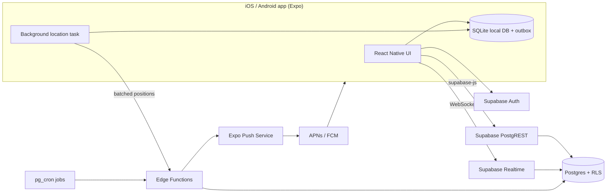
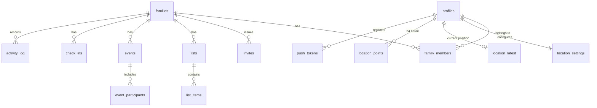

# Family Hub — Technical Specification

Sep 26, 2026 · @Oleksandr

## 1. Overview

Family Hub is a mobile-first app for iOS and Android where one household shares shopping lists, to-dos, a calendar and live location. It is built once with React Native (Expo) and Supabase, published to the App Store and Google Play, with a companion web version added in v2. The MVP targets a public store release in about 12 weeks.

### Goals

- One shared place for what to buy, what's happening and who's where
- Native feel: smooth lists, home-screen widgets later, reliable push notifications
- Real-time sync between family members, under 2 seconds on a normal connection
- Works offline for lists and the calendar (for example in a store with no signal)
- Opt-in live location that works in the background, made possible by going native

### Non-goals for the MVP

- Full web app (a read/write web companion comes in v2)
- Geofence alerts ("arrived at school") and location history beyond 24 hours
- Sync with Google or Apple calendars
- Money, budgets and payments

### Target platforms

| Platform | Minimum | Notes |
| --- | --- | --- |
| iOS / iPadOS | iOS 16+ | App Store; phone layout first, iPad runs scaled |
| Android | Android 8.0 (API 26)+ | Google Play |
| Web | Not in MVP | Expo web build as a companion in v2 |

### Users and roles

- **Owner**: created the family; manages members and settings
- **Adult**: full access to lists, calendar and location
- **Child**: can add and complete items, see the calendar and share location; cannot delete shared content or manage members

## 2. MVP scope

The MVP ships nine features in native iOS and Android apps. Going native moves live location and Apple sign-in into v1. Geofences, calendar sync, the web app and everything money-related wait for later versions.

| Feature | MVP (v1) | Later |
| --- | --- | --- |
| Accounts | Email + password, magic link, Google and Apple sign-in, biometric unlock | Passkeys (v3) |
| Family & invites | One family per user, invite link (opens the app or store) or 6-digit code, roles | Several families per user (v2) |
| Shopping lists | Multiple lists, categories, quantity, bought/unbought, quick re-add, swipe actions | Store-section ordering (v2), barcode scan, AI suggestions (v3+) |
| To-dos & chores | Assign to member, due date, done | Recurring chores with rotation (v2) |
| Calendar | Shared events, recurrence, reminders, member colors | Google/Apple two-way sync, .ics feed (v2) |
| Location | Opt-in live location in background, 24 h trail, check-in, "Where are you?" | Geofences and arrive/leave alerts (v2), longer history (v3) |
| Notifications | Native push (APNs/FCM) for changes, reminders, requests | Digest, per-list settings (v2) |
| Activity feed | Last 30 days of family changes | Filters, reactions (v3) |
| Settings | Profile, language, notification and location controls, leave/delete account | Data export UI (v2) |
| Web access | None | Web companion app (v2) |

## 3. System architecture

One React Native codebase (Expo) builds the iOS and Android apps and talks directly to Supabase. Supabase provides auth, Postgres with row-level security, realtime and storage. Edge Functions handle invites, push delivery, location fan-out and scheduled jobs. There is no custom server to run for the MVP.

### Why React Native with Expo

| Option | Verdict |
| --- | --- |
| **React Native + Expo** (chosen) | Native UI and performance, background location and native push via mature Expo modules, one TypeScript codebase for both platforms, cloud builds and over-the-air updates with EAS, web build possible later |
| Flutter | Equally capable, but Dart instead of TypeScript and a weaker Supabase/web story for this team |
| Capacitor (web app in a native shell) | Fastest if a web app already existed; list and map performance feel less native |
| Two native apps (Swift + Kotlin) | Best quality, but roughly double the cost and time |



### Technology stack

| Layer | Choice | Reason |
| --- | --- | --- |
| Language | TypeScript (strict) | One language for app and Edge Functions |
| App framework | React Native + Expo SDK (latest), New Architecture | Native apps from one codebase |
| Navigation | Expo Router | File-based routes, deep links for invites and notifications |
| Server state | TanStack Query | Caching, retries, optimistic updates |
| UI | NativeWind (Tailwind for RN) + Tamagui or React Native Reusables | Consistent design, dark mode |
| Lists and gestures | FlashList, Reanimated, Gesture Handler | Smooth long lists, swipe to buy or delete |
| Forms | React Hook Form + Zod | Shared validation schemas |
| Local data | expo-sqlite with Drizzle ORM (or WatermelonDB) | Offline cache and outbox queue |
| Secure storage | expo-secure-store | Auth tokens in Keychain / Keystore |
| Calendar UI | react-native-calendars | Month and agenda views |
| Dates | date-fns + rrule.js | Time zones and recurrence |
| Maps | react-native-maps (Apple Maps on iOS, Google Maps on Android) | Native map SDKs, no per-map-load fees |
| Location | expo-location + expo-task-manager | Foreground and background updates |
| Push | expo-notifications + Expo Push Service | One API for APNs and FCM |
| Auth providers | expo-apple-authentication, Google Sign-In | Native sign-in sheets |
| i18n | i18next + expo-localization | Language from device settings |
| Backend | Supabase (Postgres 15+, Auth, Realtime, Storage, Edge Functions) | Managed, one service |
| Build and release | EAS Build, EAS Submit, EAS Update | Cloud builds, store submission, over-the-air JS fixes |
| Monitoring | Sentry (sentry-expo) + Supabase logs | Crashes, errors, slow queries |

### Environments

- **Development**: Expo dev client on devices and simulators, Supabase CLI locally
- **Staging**: separate Supabase project; internal builds via TestFlight and Google Play internal testing
- **Production**: separate Supabase project; App Store and Google Play releases; EAS Update channel per environment

## 4. MVP functional requirements

Each feature below lists what it must do in v1. "FR" numbers are used in tickets and tests.

### 4.1 Accounts and authentication

- FR-1.1 Sign up with email + password (min 8 characters), Google or Sign in with Apple (required by App Store rules when Google sign-in is offered).
- FR-1.2 Email verification before joining or creating a family (not needed for Apple/Google).
- FR-1.3 Sign in with password or magic link (opens the app via universal link / app link); password reset by email.
- FR-1.4 Session stored in Keychain / Keystore; optional Face ID / fingerprint unlock; sign out on all devices from settings.
- FR-1.5 Profile: display name, avatar (camera or photo library), color, language, time zone.
- FR-1.6 Delete account in-app (App Store requirement): removes personal data, reassigns ownership if the user is the only owner.

### 4.2 Family and invites

- FR-2.1 After sign-up, the user either creates a family (becomes Owner) or joins with an invite.
- FR-2.2 Owner or Adult creates an invite: a shareable link and a 6-digit code, valid 7 days, single use or multi-use (up to 10).
- FR-2.3 The invite sets the new member's role (Adult or Child). Only an Owner can invite an Adult.
- FR-2.4 The invite link is a universal link (iOS) / app link (Android): it opens the app if installed, otherwise the store page, and the invite is applied after install and sign-up (deferred deep link).
- FR-2.5 Owner can change roles, remove members and revoke invites.
- FR-2.6 A member can leave the family. The last Owner must transfer ownership or delete the family.
- FR-2.7 Maximum 12 members per family in the MVP.

### 4.3 Shopping lists

- FR-3.1 A family has one or more shopping lists (default: "Groceries"). Adults create, rename, archive lists.
- FR-3.2 Item fields: name (required), quantity + unit, category, note, added by, bought by, bought at.
- FR-3.3 Tap to mark bought; bought items move to a collapsed "Bought" section and are cleared after 24 hours.
- FR-3.4 Items are grouped by category (Produce, Dairy, Meat, Bakery, Household, Pharmacy, Other). Categories are editable per family.
- FR-3.5 "Recently bought" suggestions: typing shows matching past items; one tap re-adds.
- FR-3.6 Duplicates: adding an item that already exists unbought shows "Already on the list" with an option to increase quantity.
- FR-3.7 Changes appear on other members' devices in real time.
- FR-3.8 All list actions work offline and sync when back online.

### 4.4 To-dos and chores

- FR-4.1 To-do lists share the list engine with shopping lists (type = todo).
- FR-4.2 Item fields: title, assignee (optional), due date/time (optional), note.
- FR-4.3 Assigned member gets a push notification; overdue items are highlighted.
- FR-4.4 "My tasks" view shows everything assigned to the current user across lists.

### 4.5 Calendar

- FR-5.1 Views: month, week, agenda (default on mobile: agenda).
- FR-5.2 Event fields: title, start, end or all-day, location text, participants, note, reminder (none, 10 min, 1 h, 1 day).
- FR-5.3 Recurrence: daily, weekly (selected weekdays), monthly, yearly; edit "this event" or "all events".
- FR-5.4 Events are colored by the first participant's color; filter by member.
- FR-5.5 Reminders are delivered as push notifications to participants.
- FR-5.6 Times are stored in UTC and shown in each user's time zone.
- FR-5.7 Birthdays: a member's birthday (optional in profile) appears as a yearly all-day event.

### 4.6 Location

- FR-6.1 Location sharing is off by default. A member turns it on in settings; Children need an Adult to allow it. The app explains why before showing the OS permission prompt.
- FR-6.2 Permission flow: first "While using the app", then an explained upgrade to "Always" for background sharing. Sharing still works in foreground-only mode if "Always" is declined.
- FR-6.3 Background updates use significant-change / balanced accuracy: a new position after about 100 m of movement or every 5 minutes while moving, none while stationary. Target battery cost under 5% per day.
- FR-6.4 Positions are sent in batches to the `ingest-location` Edge Function and stored as the latest position plus a 24-hour trail.
- FR-6.5 Family map shows each sharing member's latest position, time since update ("3 min ago"), and battery level. Tapping a member shows today's trail.
- FR-6.6 Manual "Check in" with an optional note ("At school") for members who don't share continuously.
- FR-6.7 "Where are you?" sends a push; if the member shares location, the app refreshes the position silently, otherwise they get a one-tap check-in.
- FR-6.8 Pause sharing for 1 hour, until tomorrow, or off; the family sees "Location paused".
- FR-6.9 Trail points older than 24 hours and check-ins older than 7 days are deleted automatically.

### 4.7 Notifications

- FR-7.1 Ask for notification permission after onboarding explains its value, never on the very first screen.
- FR-7.2 Notification types: item assigned, event reminder, "Where are you?" request, new member joined, list changed (batched: at most one per list per 10 minutes).
- FR-7.3 Each type can be turned on or off per user. Quiet hours: 22:00–07:00 by default, editable. "Where are you?" ignores quiet hours for Adults asking a Child.
- FR-7.4 Notifications carry actions where useful: "Mark done" for tasks, "Check in" for location requests.
- FR-7.5 Tapping a notification opens the related screen via deep link.
- FR-7.6 App icon badge shows the number of tasks assigned to me that are due today.

### 4.8 Activity feed

- FR-8.1 Shows family actions for the last 30 days: item added/bought, task done, event created/changed, member joined, check-in.
- FR-8.2 Each entry links to the item or event.

### 4.9 Home screen and navigation

- FR-9.1 Today dashboard: next 3 events, my tasks due today, count of items on each shopping list, family members on a mini map.
- FR-9.2 Bottom tab bar: Home, Lists, Calendar, Map, Family.
- FR-9.3 Pull to refresh on every screen; haptic feedback on marking items bought or done.
- FR-9.4 Onboarding: 3 screens (create or join family, notifications, location) that can be skipped and revisited in settings.
- FR-9.5 Dark mode following the system setting.

## 5. Data model

All family data hangs off `families.id`. Every table has `id uuid`, `created_at` and `updated_at` (timestamptz, UTC). Soft deletes use `deleted_at` so offline clients can sync deletions.



| Table | Key columns | Notes |
| --- | --- | --- |
| `profiles` | id (= auth.users.id), display\_name, avatar\_url, color, locale, timezone, birthday | One row per user |
| `families` | id, name, created\_by |  |
| `family_members` | family\_id, user\_id, role enum(owner, adult, child), joined\_at | PK (family\_id, user\_id); unique user\_id in MVP |
| `invites` | id, family\_id, code char(6), token, role, max\_uses, uses, expires\_at, created\_by, revoked\_at | Code and token unique among active invites |
| `lists` | id, family\_id, name, type enum(shopping, todo), position, archived\_at |  |
| `list_items` | id, list\_id, family\_id, title, quantity numeric, unit, category, note, assignee\_id, due\_at, is\_done, done\_by, done\_at, position, created\_by, deleted\_at | family\_id duplicated for RLS and realtime filters |
| `item_history` | family\_id, title\_normalized, category, last\_used\_at, use\_count | Powers "recently bought" suggestions |
| `categories` | id, family\_id, name, position | Seeded with defaults |
| `events` | id, family\_id, title, starts\_at, ends\_at, all\_day, timezone, rrule text, location\_text, note, reminder\_minutes, created\_by, deleted\_at | Recurrence expanded on client |
| `event_exceptions` | event\_id, original\_start, is\_cancelled, override jsonb | "Edit this occurrence" |
| `event_participants` | event\_id, user\_id |  |
| `location_settings` | user\_id, family\_id, mode enum(off, foreground, always), paused\_until, allowed\_by | allowed\_by required for Children |
| `location_latest` | user\_id (PK), family\_id, lat, lng, accuracy\_m, battery\_pct, recorded\_at | One row per user, upserted; drives the map |
| `location_points` | id, user\_id, family\_id, lat, lng, accuracy\_m, recorded\_at | 24-hour trail; deleted hourly |
| `check_ins` | id, family\_id, user\_id, lat, lng, accuracy\_m, note, created\_at | Deleted after 7 days |
| `location_requests` | id, family\_id, from\_user, to\_user, created\_at, answered\_at |  |
| `push_tokens` | id, user\_id, provider enum(expo, webpush), token, web\_endpoint, web\_keys jsonb, platform enum(ios, android, web), device\_name, last\_seen\_at | One per device |
| `notification_prefs` | user\_id, type, enabled, quiet\_start, quiet\_end |  |
| `activity_log` | id, family\_id, actor\_id, verb, entity\_type, entity\_id, summary jsonb, created\_at | Written by triggers; kept 30 days |

### Indexes

- `list_items (list_id, is_done, position)` and `(family_id, updated_at)` for sync
- `events (family_id, starts_at)`
- `check_ins (family_id, user_id, created_at desc)`
- `activity_log (family_id, created_at desc)`

## 6. Security and privacy

Row-level security (RLS) is enabled on every table. A user can read or write a row only if they are a member of that row's family, and roles limit what they can change.

### RLS pattern

```sql
-- helper: is the current user in this family, optionally with one of these roles
create function is_member(fid uuid, roles role_t[] default null)
returns boolean language sql stable security definer as $$
  select exists (
    select 1 from family_members
    where family_id = fid and user_id = auth.uid()
      and (roles is null or role = any(roles))
  );
$$;

alter table list_items enable row level security;
create policy "members read"   on list_items for select using (is_member(family_id));
create policy "members insert" on list_items for insert with check (is_member(family_id));
create policy "members update" on list_items for update using (is_member(family_id));
create policy "adults delete"  on list_items for delete using (is_member(family_id, '{owner,adult}'));
```

### Permissions by role

| Action | Owner | Adult | Child |
| --- | --- | --- | --- |
| Add, edit, complete list items and tasks | Yes | Yes | Yes |
| Delete items, create or archive lists | Yes | Yes | No |
| Create and edit events | Yes | Yes | Own events only |
| Invite Adults | Yes | No | No |
| Invite Children | Yes | Yes | No |
| Change roles, remove members | Yes | No | No |
| See check-ins on the map | Yes | Yes | Yes |
| Allow a Child's location sharing | Yes | Yes | No |
| Delete the family | Yes | No | No |

### Privacy rules

- Location sharing is opt-in, per member, and can be switched off at any time; switching off deletes that member's latest position and trail.
- Trail points are removed after 24 hours by an hourly job, check-ins after 7 days and activity entries after 30 days by a nightly `pg_cron` job.
- Account deletion removes the profile, check-ins, push subscriptions and preferences; list items and events keep content but show "Former member".
- Data export (JSON) is available on request in the MVP, with a self-service button in v2.
- Hosting in an EU region to simplify GDPR compliance; a privacy policy and terms are required before public launch.
- Children's accounts: parental consent is recorded by the inviting Adult (GDPR requires it under 13–16 depending on country).

### Other security measures

- Invite tokens are random 128-bit values; 6-digit codes are rate-limited (5 attempts per minute per IP) in the Edge Function.
- Service role key is used only in Edge Functions, never in the client.
- Content Security Policy, HTTPS only, secure cookies handled by Supabase Auth.
- Dependency scanning (Dependabot) and Supabase security advisor checks in CI.

## 7. Mobile app: offline, push and background location

The app reads from a local SQLite database, so it opens instantly and works offline. Changes sync through an outbox when the connection returns; push and background location use native OS services.

### App configuration

- Bundle id / package: `app.familyhub` (placeholder); app name "Family Hub"
- Icons and splash screen generated by Expo; adaptive icon on Android
- Universal links (iOS) and app links (Android) on the invite domain, for example `familyhub.app/join/<token>`
- Permissions declared with usage strings: location (when in use + always), notifications, camera and photos (avatar)
- iOS background modes: location, remote notifications. Android: foreground service for location with a persistent "Sharing location with family" notification

### Offline data sync

1. On sign-in the app loads the family's lists, open items, the next 90 days of events and latest positions into SQLite.
2. The UI always reads from SQLite, so it renders the same online or offline.
3. Every write is applied locally first (optimistic), then added to an **outbox** table with a client-generated UUID.
4. When online, the outbox is sent in order. Writes are idempotent (upsert by id), so retries are safe.
5. Realtime events update SQLite. On app foreground or reconnect, the app pulls rows with `updated_at` newer than its last sync time.
6. Conflicts: last write wins per row, using server `updated_at`. For lists this is acceptable.
7. Deletions sync as `deleted_at` so offline devices learn about them.
8. A background fetch task (expo-background-fetch) flushes the outbox and refreshes data periodically when the OS allows.

### Push notifications

- expo-notifications registers the device and returns an Expo push token, saved in `push_tokens`.
- The `send-push` Edge Function looks up tokens for target users, respects preferences and quiet hours, and calls the Expo Push API, which forwards to APNs (iOS) and FCM (Android).
- Receipts are checked; tokens reported as `DeviceNotRegistered` are deleted.
- Notification categories provide action buttons ("Mark done", "Check in").
- A silent (data-only) push asks a sharing member's device for a fresh position after "Where are you?".

### Background location

- expo-location `startLocationUpdatesAsync` with a task defined by expo-task-manager.
- Settings: balanced accuracy, `distanceInterval` 100 m, `deferredUpdatesInterval` 5 min, `pausesUpdatesAutomatically` on iOS, activity type "other".
- The task writes points to SQLite and uploads them in batches (at most once a minute) to `ingest-location`.
- If the OS kills the app, iOS significant-location-change relaunches it; Android keeps the foreground service running.
- Battery level is read with expo-battery and sent with each batch.
- A heavier library (Transistorsoft react-native-background-geolocation, paid license) is the fallback if Expo's module proves unreliable in testing.

### Store requirements to plan for

- Apple review needs a clear reason for "Always" location, shown in the app and in review notes, plus a demo account.
- Google Play requires a background location declaration form and a short video of the feature.
- Both stores require a privacy policy URL and data safety / privacy nutrition labels.
- In-app account deletion is mandatory (FR-1.6).

## 8. Web-ready architecture

The MVP ships only on phones, but it is built so a web app in v2 reuses the same backend, the same sync protocol and most of the app code, with no data migration. Every rule below applies from the first commit.

### Principles

1. **The backend is the only source of truth.** iOS, Android and web are equal clients of the same Supabase API, RLS policies and realtime channels. No mobile-only endpoints or mobile-only business rules in the database.
2. **The sync protocol is platform-neutral.** Client-generated UUIDs, server `updated_at`, soft deletes, idempotent upserts and `sync_changes(since)` work the same from a browser. The web client implements the same outbox.
3. **Business logic lives in shared packages** with no React Native or browser imports: types, validation, recurrence, permissions, sync engine.
4. **Platform-specific code sits behind interfaces**, with `.native.ts` and `.web.ts` implementations resolved by the bundler.
5. **Every feature ticket states its web behavior**: full, read-only, or hidden on web.
6. **Multi-device is the normal case.** A user may be signed in on a phone and a browser at once; sessions, push targets and realtime subscriptions are per device, never per user.

### Monorepo structure

```text
apps/
  mobile/          Expo app: iOS + Android in MVP, web target in v2
  site/            (v2, optional) static landing / marketing site
packages/
  core/            domain types, Zod schemas, recurrence, role permissions
  data/            Supabase client, repositories, sync engine, outbox
  storage/         LocalStore interface: sqlite.native.ts, indexeddb.web.ts
  ui/              shared components (NativeWind, react-native-web compatible)
  i18n/            translations
supabase/          migrations, Edge Functions, pgTAP tests
```

Tooling: pnpm workspaces + Turborepo. Screens import data only through `packages/data` repositories, never Supabase or SQLite directly.

### Platform adapters

| Capability | iOS / Android (MVP) | Web (v2) |
| --- | --- | --- |
| Local database | expo-sqlite | IndexedDB (Dexie) or SQLite WASM on OPFS, same `LocalStore` interface |
| Outbox flush | App foreground, reconnect, background fetch | Tab focus, `online` event, service worker |
| Session storage | expo-secure-store | Browser storage with Supabase PKCE flow |
| Sign-in | Native Apple and Google sheets | OAuth redirect flows for Apple and Google |
| Push | Expo Push → APNs / FCM | Web Push (VAPID) via the same `send-push` function |
| Maps | react-native-maps (`FamilyMap.native.tsx`) | MapLibre GL JS or Google Maps JS (`FamilyMap.web.tsx`) |
| Location sharing | Background sharing | View family map only; optional one-time check-in via browser geolocation |
| Deep links | Universal links / app links | The same URLs are normal web routes |
| Haptics, biometrics, widgets | Native | No-op adapters |
| Camera / photo picker | expo-image-picker | File input (expo-image-picker web fallback) |

### Decisions baked into the MVP

- [ ] `push_tokens` is provider-generic from day one: `provider` (expo, webpush), `token`, nullable `web_endpoint` and `web_keys`, `platform` (ios, android, web). No migration needed for web push.
- [ ] One domain for everything: invite and deep links (for example `familyhub.app/join/<token>`, `/lists/<id>`, `/events/<id>`) match Expo Router routes, so the same link opens the app on a phone and the web app on a computer later.
- [ ] OAuth web redirect URLs and the Apple Services ID are registered during MVP setup.
- [ ] Prefer libraries that support react-native-web (Expo Router, NativeWind, Reanimated, FlashList); native-only libraries are wrapped in adapters.
- [ ] CI runs a web export build (`expo export --platform web`) as a smoke check from week 1, so web-incompatible imports fail early even before the web app exists.
- [ ] Realtime and conflict handling are tested with two devices editing the same list; this covers phone + browser later.
- [ ] "Sign out on all devices" and account deletion revoke every session and push token, whatever the platform.
- [ ] Edge Functions check the caller's JWT and never assume a mobile client (no reliance on device headers).

### Web version options (decided in v2)

| Option | Best when |
| --- | --- |
| **Expo Router web build of the same app** (recommended) | Signed-in family use on a computer; maximum code reuse |
| Next.js app reusing `packages/core`, `data`, `ui` | Public pages need SEO or server rendering |

Recommendation: Expo web for the app itself, plus a small static landing page for marketing if the product goes public.

## 9. Backend API and realtime

Most reads and writes go straight to tables through supabase-js, protected by RLS. Operations that need elevated rights or side effects run as Postgres functions (RPC) or Edge Functions.

### Postgres functions (RPC)

| Function | Purpose |
| --- | --- |
| `create_family(name)` | Creates the family and adds the caller as Owner in one transaction |
| `set_member_role(family_id, user_id, role)` | Owner only; blocks removing the last Owner |
| `remove_member(family_id, user_id)` | Owner only, or self (leave) |
| `sync_changes(family_id, since timestamptz)` | Returns rows changed since a timestamp across lists, items, events, check-ins |
| `suggest_items(family_id, prefix)` | Top 8 matches from `item_history` |

### Edge Functions

| Function | Trigger | Purpose |
| --- | --- | --- |
| `create-invite` | App | Generates token and 6-digit code, returns a universal link |
| `accept-invite` | App | Validates code or token, rate-limits, adds member |
| `send-push` | Database webhook / other functions | Delivers push by provider: Expo Push API in MVP, Web Push added in v2; checks receipts |
| `ingest-location` | App background task | Validates batch, upserts `location_latest`, inserts `location_points`, respects pause and settings |
| `request-location` | App | Records a "Where are you?" request, sends a silent push to refresh position plus a visible one if needed |
| `event-reminders` | pg\_cron every minute | Finds reminders due in the next minute (including recurrences) and pushes them |
| `cleanup` | pg\_cron hourly + nightly | Hourly: trail points over 24 h. Nightly 03:00 UTC: check-ins, activity, bought items, expired invites, stale push tokens |

### Database triggers

- `updated_at` auto-set on every update.
- Insert/update on `list_items`, `events`, `family_members`, `check_ins` writes an `activity_log` row.
- Assigning `list_items.assignee_id` calls `send-push` for the assignee.
- Inserting a bought item upserts `item_history`.

### Realtime channels

- One channel per family: `family:{family_id}`.
- Postgres changes subscribed with a filter `family_id=eq.{id}` on `list_items`, `lists`, `events`, `location_latest`, `check_ins`, `family_members`.
- The app subscribes while in the foreground and unsubscribes in the background to save battery; push and the sync pull cover the rest.

## 10. Quality, testing and operations

### Non-functional requirements

| Area | Target |
| --- | --- |
| Cold start (mid-range Android) | Under 2 s to the Home screen with cached data |
| Scrolling | 60 fps on lists of 200 items |
| Sync latency | Change visible on another device in under 2 s (app in foreground) |
| Battery (location sharing on) | Under 5% per day for a typical day |
| App size | Under 40 MB download |
| Crash-free sessions | 99.5%+ |
| Accessibility | VoiceOver and TalkBack labels, Dynamic Type / font scaling, 44 pt tap targets, WCAG AA contrast |
| Localization | All strings in i18n files; dates and numbers formatted by locale |
| Scale (MVP) | Up to 1,000 families on the Supabase Pro plan without changes |

### Testing

- **Unit**: Jest for sync logic, recurrence expansion, validation schemas.
- **Component**: React Native Testing Library for key screens.
- **Database**: pgTAP tests for every RLS policy (member vs non-member vs child).
- **End-to-end**: Maestro flows for sign-up, invite, add/buy item, create event, offline add then reconnect.
- **Location field tests**: a week of real-world use on at least 2 iPhones and 3 Android brands (Samsung, Xiaomi, Pixel) to check battery and killed-app behavior.
- **Beta**: TestFlight and Google Play internal testing before each store release.

### CI/CD

- GitHub Actions on each pull request: typecheck, lint, unit tests, pgTAP, Maestro on EAS or an emulator.
- EAS Build creates iOS and Android binaries; EAS Submit uploads them to the stores.
- EAS Update ships JavaScript-only fixes over the air; native changes require a new store release.
- Database migrations in `supabase/migrations`, applied to staging on merge and to production on release tag.

### Monitoring

- Sentry for crashes, JS errors and Edge Function errors, with release and update tracking.
- Supabase dashboards for slow queries and Realtime connections.
- Store consoles (App Store Connect, Play Console) for ratings, crashes and ANRs.
- Privacy-friendly product analytics (for example PostHog, self-hosted or EU) for activation and weekly active families.

## 11. MVP delivery plan

The MVP takes about 12 weeks for one full-time developer, or 7–8 weeks for two, plus 1–2 weeks for store review. Live location adds about 2 weeks compared with the earlier PWA plan. Each phase ends with an internal build on TestFlight and Google Play internal testing.

| Week | Phase | Deliverables |
| --- | --- | --- |
| 1 | Foundation | Monorepo with shared packages (section 8), Expo project, EAS builds, CI with web export check, Supabase projects, design system, i18n, navigation shell, base schema and RLS helpers; Apple and Google developer accounts |
| 2–3 | Accounts and family | Email, Google and Apple sign-in, biometric unlock, profiles, create family, invites with universal links, roles, member management |
| 3–5 | Lists | Shopping and to-do lists, categories, suggestions, swipe actions, realtime, SQLite cache and outbox |
| 5–7 | Calendar | Month and agenda views, events, recurrence and exceptions, participants, birthdays |
| 7–8 | Notifications | Native push, preferences, quiet hours, event reminders, notification actions, badges |
| 8–10 | Location | Permission flow, background updates, ingest function, family map, 24 h trail, check-in, "Where are you?", pause controls |
| 10–11 | Home, activity, settings | Today dashboard, activity feed, onboarding, account deletion, cleanup jobs |
| 11–12 | Hardening and beta | Location field tests, offline tests, performance, accessibility, privacy policy, store listings, beta with 3–5 families |
| 12–13 | Store release | App Store and Google Play review, fixes, public launch |

### MVP definition of done

- [ ] Every FR in section 4 passes its tests on iOS and Android
- [ ] RLS tests pass for every table
- [ ] Offline add/buy/complete works and syncs without data loss
- [ ] Push arrives on both platforms, including notification actions
- [ ] Background location keeps updating for 24 hours on test devices within the battery target
- [ ] Non-functional targets from section 10 are met
- [ ] Privacy policy, terms and store privacy labels published
- [ ] Approved on the App Store and Google Play
- [ ] At least 3 real families used it for 2 weeks with no blocking bugs

## 12. Version 2

Version 2 adds geofences, calendar sync, a web companion and multi-family support. It is estimated at 8–10 weeks after launch, and priorities should follow beta and store feedback.

### 12.1 Places and geofences

- Family-defined places (Home, School, Work, Grandma's) as circles of 100–500 m.
- Arrive/leave alerts via expo-location geofencing (iOS limit: 20 regions per app, enough for a family).
- Per-place settings: who gets notified, and at what times (for example school days only).
- Location history extended to 7 days for Adults who opt in.

### 12.2 Calendar sync

- Google Calendar two-way sync via OAuth and watch channels, mapping events by external id.
- Device calendar integration with expo-calendar: show family events in the phone's Calendar app, and optionally overlay a member's own events.
- Read-only .ics subscription URL per family.

### 12.3 Web app and sync

- Web target of the same Expo app, reusing `packages/core`, `data` and `ui` as prepared in section 8.
- Full two-way sync with phones: same Supabase API, realtime channel and outbox protocol; the web `LocalStore` uses IndexedDB so lists work offline in the browser.
- Web Push notifications through the existing `push_tokens` table (`provider = webpush`).
- Installable as a PWA on desktop; shows the family map but does not share location in the background.
- Estimated 3–4 weeks thanks to the MVP groundwork, mostly layout work for wide screens (sidebar navigation, week calendar view, keyboard shortcuts).

### 12.4 Other v2 features

| Feature | Notes |
| --- | --- |
| Home screen widgets | iOS WidgetKit and Android Glance widgets (via Expo config plugins): shopping list count, next event, where everyone is |
| Multiple families per user | Family switcher; RLS already scoped by family\_id, remove the unique user\_id constraint |
| Recurring chores with rotation | Weekly rotation between members, streaks for kids |
| Shared notes and documents | Rich-text notes, file uploads (Supabase Storage) for passports, insurance, school papers; Adults-only option |
| SOS button | One tap sends the current position and an urgent push to all Adults |
| Notification digest | Daily summary instead of single alerts |
| Self-service data export | JSON and CSV download from settings |
| Store-section ordering | Remember item order per store |

## 13. Version 3 and later

These features are candidates, ordered by expected value. None of them needs changes to the MVP architecture.

| Version | Feature | Technical notes |
| --- | --- | --- |
| v3 | Family budget and expenses | Expense entries, categories, monthly totals, split between members; new `expenses` table |
| v3 | Meal planner | Weekly plan with recipes; "add ingredients to shopping list" button |
| v3 | Photo album | Supabase Storage with image resizing; per-event albums |
| v3 | Family chat | Realtime channel messages with reactions, or comment threads on items and events |
| v3 | Apple Watch and Wear OS | Glanceable shopping list and "check in" from the wrist |
| v3 | Passkeys | Native passkey sign-in through Supabase Auth |
| Later | AI suggestions | "You usually buy eggs weekly" from `item_history`; smart categorization of new items |
| Later | Voice and barcode input | On-device speech recognition; barcode via expo-camera and an open product database |
| Later | Siri Shortcuts and Google Assistant | "Add milk to the family list" via App Intents / App Actions |
| Later | Driving and safety insights | Arrival notifications for trips, speed alerts (opt-in, sensitive) |
| Later | Monetization (if public) | Free tier for one family; paid plan via in-app purchase (RevenueCat) for longer history, places, storage |

## 14. Open questions and risks

### Open questions

- [ ] Is this only for our family, or a public product? This decides privacy work, store listing effort and monetization.
- [ ] Do children get their own accounts on their own phones, or profiles managed by parents?
- [ ] Which languages are needed at launch?
- [ ] Should one user belong to several families already in the MVP (for example grandparents)?
- [ ] Is live location a must for launch, or can it ship as a 1.1 update to reach the stores \~2 weeks sooner?

### Risks

| Risk | Impact | Mitigation |
| --- | --- | --- |
| App Store or Play rejects background location | Launch delay | Clear in-app explanation, review notes and demo video; foreground-only fallback; allow 2 weeks for review |
| Android vendors (Samsung, Xiaomi, Huawei) kill background apps | Stale positions | Foreground service, in-app guide to disable battery optimization, "last updated" shown on the map |
| Battery drain complaints | Uninstalls, sharing turned off | Balanced accuracy, distance filter, stop when stationary, measure in field tests |
| Offline sync bugs cause lost or duplicated items | Loss of trust | Idempotent writes, outbox tests, soft deletes, beta period |
| Native release cycle slows fixes | Bugs stay live longer | EAS Update for JS fixes; staged rollouts in both stores |
| Legal requirements for children's and location data | Compliance risk if public | EU hosting, consent records, retention jobs, legal review before public launch |
| Supabase limits or outage | App unavailable | Pro plan, offline mode covers short outages, regular backups |
| Scope creep | MVP delayed | Anything not in section 4 goes to the v2 backlog |
